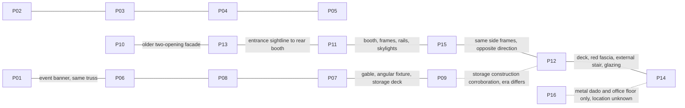

# TOLI workshop spatial constraints — final evidence-driven pass

All 16 original-resolution photos re-inspected on 19 October 2026, before requesting new evidence or editing the existing refined model. P13 AVIF was decoded losslessly to PNG only for inspection; no reference was warped, retouched or cropped for alignment. IDs and original hashes: `tools/3d/toli-workshop/reference/inventory.json`.

## Relationship map

P02–05 show four frontage openings; P10/P13 show two main workshop openings plus a smaller adjacent shop opening at the left edge. Their geometry must not be blended. P10/P12/P14 visibly carry the same 2024 date. This pass uses the **2024 two-main-opening workshop configuration with the smaller left frontage** for facade/interior consistency; this is a documented reference-era choice, not a claim about today's facade. P01/06/07/08/09 corroborate construction and fixture/deck types; their occluded location/possible later configuration is not a reliable new floor-plan constraint.

## Photo-by-photo reanalysis

| Photo | Repeated landmarks and spatial contribution | Limit |
| --- | --- | --- |
| P01 | Same event banner, dark triangular roof web, angular fixture edge, storage fabric at right as P06–09 | Floor and office junction entirely occluded |
| P02 | Four-opening newer frontage, central open vehicle entry, white piers; same fascia corner/side shed as P03–05 | Different configuration from dated 2024 interior |
| P03 | Four openings and projecting right sign panel; front horizontal directions across full facade | Parked vehicles hide bases |
| P04 | Near-frontal central entry and four pier/shutter divisions | No interior office geometry visible |
| P05 | Same four-opening frontage, side access at right, distant roofline | Too distant for detailed junctions |
| P06 | Banner overlap with P01/P08, roof truss rhythm | Foreground excluded |
| P07 | Gable, full angular fixture corner, roof ribs/purlins, pale deck edge | Banner occludes room below |
| P08 | Same roof/banner landmarks, storage at right | No floor control points |
| P09 | Deep red deck edge, thick underside support, metal railing with horizontal rails, storage behind; overlap roof in P07 | Location relative to 2024 office not proved; do not force eras into one plan |
| P10 | Two main openings, main red center pier, small attached shop at left, thin corrugated canopy, short sign band, visible right side shed | Perspective and adjacent shop can mislead total frontage measurement |
| P11 | Forward lane, right red frame sequence, rear booth, rear-left bright opening, paired skylights, dark wall rails | Vehicles obscure bases; use them as scale cues only |
| P12 | Same frames seen in reverse, front opening at right, office/deck at end of frame-side bays; stair beside office, not projecting prominently into lane | Cars obscure lower stair and door threshold |
| P13 | Two main shutters, center pier, canopy; direct lane-to-booth sightline joins exterior to P11/P15 | Wide-angle distortion; facade corners partly clipped/occluded |
| P14 | Door in end plane, deep side glazing at image left, stair seen through that glazing ascending away from doorway; back desk/cabinet; wood floor/white ceiling | No full room plan, lens metadata absent |
| P15 | Overlaps P11 booth and frame order; side-wall pale openings, frame-to-eave height, panel/rib scale | No booth rear depth or unoccluded wall footings |
| P16 | Corrugated wall, pale dado, dark/brown office flooring compatible with office materials | No common door/window/column proves its location; do not add hidden room |

## Feature constraints

| FEATURE | VISIBLE IN PHOTOS | RELATION TO OTHER FEATURES | CONFIDENCE | CURRENT MODEL MISMATCH | PROPOSED CORRECTION |
| --- | --- | --- | --- | --- | --- |
| Main 2024 facade | P10, P13 | Two main openings share center pier; short sign band above thin canopy; shed behind | HIGH opening count, MEDIUM silhouette ratio | Oversized blank sign band and camera on wrong side | Reduce sign-band/clear-opening ratio, lower corresponding roof envelope conservatively, view from right as P10; keep separate neutral signage |
| Facade era | P02–05 versus P10/P13 | Four-opening and two-opening variants cannot constrain one frontage simultaneously | HIGH difference, LOW chronology details | Prior report treated mainly as sign-art difference | Explicit 2024 configuration; no adjacent shop or new configuration silently invented |
| Opening to sign-band ratio | P10, P13 | Canopy is shared horizontal datum between sign band and shutter height | MEDIUM | Sign band taller than clear opening | Target band/opening about 0.75–0.85 in the P10 camera; do not derive metres from pixels |
| Eave/frame height | P11, P15 | Red frame tops below but fairly close to wall/eave line | MEDIUM | Roof/wall too tall relative to red frames | Compress only upper architecture above frame top; retain office, frames and floor scale |
| Reception front plane | P12, P14, corroborating construction P09 | End plane beneath mezzanine faces workshop; deep side glass shows external stair | MEDIUM (cross-view interpretation) | Current door/glass front faces across lane and is wider/shallower in its comparison | Reuse existing front glazing rotated onto workshop-facing end; depth extends behind it |
| Reception side plane | P14, P12 | Stair visible beyond image-left side glass; counter/cabinet at room back | MEDIUM | Glazed side and stair are reversed relative to doorway comparison | Put side glass on stair side; keep opposite side conservative and opaque |
| Mezzanine front edge | P12, P09 | Red structural fascia above office glazing, railing above that, thicker underside beam | HIGH construction, MEDIUM placement | Deck plausible but front/side relation weak | Retain deck, shift with office, reinforce front support contact; no speculative extra level |
| Stair | P12, P14 | External straight flight on side beside office; ascends away from doorway view toward deck | MEDIUM side/orientation, LOW exact width/landing | Detailed stair prominently projects into lane on opposite side | Move existing flight beside outer glazed wall; narrow conservatively; simplify/remove unsupported railing detail if needed; tag exact landing LOW |
| Lane | P11, P13, P15 | Runs from main open shutter toward rear booth; yellow edges, service areas each side | HIGH topology, MEDIUM width | Symmetrical camera makes lane look too centered and broad | Adjust photographic camera toward right half of lane, level horizon; avoid global rescaling to compensate for camera |
| Booth front | P11, P13, P15 | Rear booth slightly offset from lane; cream perimeter, red leaves, tall rounded dark windows | HIGH appearance, MEDIUM dimensions | Window height/position and pristine surface are simplified | Preserve supported frontal shell; tune proportion/window placement using joint views |
| Booth hidden depth | P11, P15 | Short visible side skin; most back/roof hidden | LOW | Previously treated as a readiness blocker | NON-BLOCKING ESTIMATE; keep conservative closed shell, no interior grating/ductwork |
| Rear-left opening | P11/P13 | Bright opening immediately beside booth | MEDIUM position, LOW jamb width | Flat pale placeholder in current renders | Keep opening; do not invent distant building; width estimate NON-BLOCKING |
| Pale wall openings | P11/P12/P15 | Low pale rectangular areas between frame/column positions | HIGH existence, MEDIUM type | Flat floating plaques instead of flush panels/openings | Flush with wall, add thin surrounding frame/seam; limit emission rather than fake luminous walls |
| Floor slab scale/wear | P11/P13/P15 | Slabs small compared with car footprint/lane width, pale worn joints; broad subdued variation | HIGH type, MEDIUM module size | Slabs too large, smooth and checker-like | Smaller unequal modules, consistent world UVs, worn edge breakup/roughness variation; no debris/stain copying |
| Corrugation scale | P07/P11/P12/P15/P16 | Numerous narrow vertical wall ribs and down-slope roof ribs | HIGH direction, MEDIUM pitch | Material frequency low relative to wall openings | Increase rib frequency modestly, retain normal-based approach and restrained roughness variation |
| Structural repetition | P11/P12/P15 | Trusses span width; wall rails, purlins, frame sequence converge consistently | HIGH topology, MEDIUM spacing | Generic rhythm, camera previously tilted too high | Keep hierarchy and shared materials, calibrate cameras first; no unsupported exact bay distances |
| Angular fixtures | P01/P07/P09/P11/P15 | Thin polygonal tubes under trusses with small suspension lines | HIGH type, MEDIUM size/spacing | Overlarge nearest fixture dominates comparison | Reuse/scale fixture geometry modestly after architecture; no new live light per tube |

## Perspective and camera procedure

Use fixed original pixel frames and aspect ratios. Original photographs are not warped or cropped. Overlay sheets use only a documented uniform display resize; native originals remain untouched. Render cameras are changed, never the photo projection.

P10 control points (approximate manual picks, ±10–20 px for partly hidden bases): full common fascia top left (192,389), top right (800,329), canopy left (192,525), canopy right (810,493), base left (190,700), base right (810,680); right shed rear/eave vicinity (1040,535). The smaller left frontage belongs under the shared fascia but is not one of the main two workshop openings. Corresponding model plane points and reprojection residuals are retained with camera analysis. Sign-band/opening ratios are checked within the same facade plane, not across unrelated photos.

P11: estimate a near-level camera around standing eye height in the **right half** of the lane; booth and lane appear left of the principal point in the near floor. Fit direction/FOV to rear booth, wall/eave corners and lane convergence before judging width. Foreground vehicles are occluders, not model geometry. A single uncalibrated wide-angle image does not establish surveyed width/depth.

P14: keep door jambs close to vertical, standing-height level camera just outside the end doorway, looking down room depth. Left-side glazing must reveal the stair. The current across-lane camera cannot test this relation. Use doorway width, sill level and back wall as primary anchors; avoid fitting furniture/clutter.

P12/P15: use opposing frame order and wall rails to check direction and bay rhythm. P12 mezzanine comparison retains the full image despite floor occlusion; no crop removes incorrect architecture. Camera height, lens, pose and target are stored in `reference/evidence-final/camera-analysis.json` after the corresponding pass.

## Uncertainty policy

NON-BLOCKING ESTIMATE: absolute dimensions, hidden booth depth/interior, exact rear jamb width, unlocated P16 room omitted, period-specific signage art, stair width/landing details after conservative simplification. None alone fails the visual gate.

BLOCKING MISSING REFERENCE only if the corrected visible office/stair relationship still contradicts P12/P14 after camera matching: one view from just behind the first red frame showing entire office end, stair foot/top and mezzanine corner in one image. The current facade version is an optional future scope choice, not a blocker for a consistently labeled 2024 reconstruction. No new photograph is requested before the six-pass comparison work.

### Facade anchor review before reception pass

The first camera fit incorrectly used the TOLI signboard's left edge as the whole facade's left edge. It produced a 34.38-pixel unweighted RMS residual and an implausible two-bay-only composition. Re-inspection of P10/P13 resolves this using existing evidence: the narrow left shop frontage shares the canopy/fascia and must be included in the exterior silhouette, without inventing its hidden interior. Revised full-fascia controls give a 19.07-pixel unweighted RMS residual at 1440×1080, with lower weight on obscured ground points/rear roof edge. These are manual approximate controls, not precise calibration. Residuals and a camera-height bound indicate remaining projection uncertainty; they do not establish visual PASS.

The rendered first facade pass additionally exposed a stale mesh-bounds update in the existing sign surface after upper-envelope compression. The ordered edit script now sets explicit mesh bounds for that surface; no change to reference pixels is used to conceal the defect. The faulty intermediate render is retained as an iteration artifact, not a final validation view.

### Reception joint camera/depth check

P14 doorway spans roughly x550–1100 in the 1728-pixel frame, with the sill near y940 and back-ceiling junction around y300 (approximate picks; occlusion/distortion limits precision). A level camera with a 32 mm/36 mm sensor assumption, front distance about 2.37 presentation units and height about 1.32 reproduces doorway width and sill together. The prior 6.25-unit room depth places the rear ceiling too low in the image; a conservative 4-unit depth places it nearer the photographed junction. These are coupled camera/relative-proportion estimates, not measured metres. The deck behind the room retains its existing footprint; no hidden room is added under the remainder. The exterior stair interpretation is tested in the next pass rather than hidden from this view.

The main vehicle opening is narrower than the full internal aisle. Front lane guides are conservatively joined to the retained straight lane over the first bay, preventing paint from crossing the newly corrected entrance pier. Exact threshold paint is a NON-BLOCKING ESTIMATE.

### Lane/booth cross-view result

The forward photo constrains the booth left of the roof ridge, the first inner red frame at the right edge and both yellow lane boundaries. The final bounded fit keeps shell dimensions, lane width and booth-front dimensions fixed; it adjusts camera pose/FOV and only two relative offsets. Estimated lane centre is -0.922 and booth centre -1.198 in root-local presentation units (not metres). The entrance centre is approximately -1.3 on the same axis, so these now relate coherently rather than imposing a symmetric aisle. The forward architectural controls have 9.03 pixels RMS error in the native 1434×1080 frame; the nearest red-frame target is x1330 and the projection is 1329.92. These residuals measure approximate hand-picked controls only.

A trial camera constrained to be entirely beyond the office was rejected as an unsupported assumption. The repeated foreground frame is a stronger control than that assumed camera position. The resulting pose is cross-checked from the opposite lane and P15 rather than treated as a surveyed solution.

Booth depth remains NON-BLOCKING. Its front, width relationship and rear position are constrained; no unseen mechanics/interior are added. The rear opening is now actual open geometry with a bright validation sky, replacing the earlier flat daylight placeholder.

### Material review

Corrected slab and board scale, narrower corrugation frequency, reusable colour/roughness maps and flush pale panel frames. An initial floor variation was visibly too cloudy in a test render; its broad tonal amplitude was reduced before final validation. No bent structure, copied stains, debris, people, vehicles or event dressing were introduced. Architecture mode alone is sufficient; no temporary decoration layer is necessary for these structural comparisons.

### Final frame-axis correction from opposing photographs

Full-resolution coordinate checks of P12 and P15 show that the red frame tops lie nearly on a common line **parallel to the side-wall rails**. The earlier across-width pairs were incorrect: they projected with the wrong cross-tie direction in both opposing views. Each existing frame assembly was rigidly rotated −90° around its retained aisle-side anchor (root X3.65, Y10/17/24). Its paired post now lies 3.8 root units nearer the entrance on the same X line. These numbers describe relative editable coordinates, not measured metres. This changes orientation without replacing the reconstruction or adding lift mechanisms.

The reception/stair assembly moves one root unit toward the entrance to clear the first corrected frame. The office end plane is now Y5.7, room back Y1.7; the deck front follows Y5.7 while the rear remains Y0.45. The railing opening is kept beside the stair landing and closed at the obsolete lane-side gap. The room still has a simplified opaque lane wall; whether every part of that face was glazed cannot be established from the obstructed distant view. Exact frame spacing remains MEDIUM confidence; direction is HIGH confidence.

The old camera solution using across-width frame pairs was rejected. A later unrestricted reverse-camera fit also landed behind the booth and was rejected because the wall obstructed the view. Final fitting constrains the camera to the open aisle and a moderate focal range. Landmark residuals alone cannot override a visibly invalid camera. No geometry was stretched to match those failed camera solutions.

### Reception lane wall review

The final reverse inspection exposed the remaining solid white lane-facing wall. P12 shows glazing below the wrapping red deck edge, not a full-height white slab. The existing wall was retained as a grey lower dado; shared side-glass/sill geometry and simple red mullions complete the upper face. A continuous lane-side red fascia joins the two existing end fascias. This is a visible architectural correction from the existing photograph; no hidden furniture or speculative room was added. It supersedes the earlier conservative opaque-wall assumption above. Glazing extent is MEDIUM confidence; the precise mullion spacing is a NON-BLOCKING ESTIMATE.

### Joint relative frame spacing, final correction

The initial rigid-axis correction retained the old 3.8-unit pair span and 7-unit anchor spacing. With the reverse camera constrained ahead of the booth and to a moderate focal range, these inherited distances produced a visibly poor 76.19-pixel native-frame RMS fit. This was not accepted as successful camera calibration.

A simultaneous bounded fit uses both opposing photographs, fixes the first aisle anchor at Y10, shares one pair span and one repeated anchor spacing across all frames, and fits a separate rigid camera/FOV for each view. It estimates pair span **2.645** and anchor spacing **6.156** in root presentation units. Only longitudinal placement and cross-tie length change; post height/section and the anchored first post remain fixed. The shared solution gives approximately **11.35 px RMS in P12** and **9.39 px RMS in P15**, including lower-weight office/partly cropped booth controls. This supersedes the inherited 3.8/7 distances. Exact inputs, bounds, projected controls and poses are in `reference/evidence-final/frame-spacing-fit.json` and its analysis script.

P12 uses a 20 mm/36 mm sensor assumption at the upper 2.4-unit camera-height bound; P15 approximately 28 mm at the lower 1.3-unit bound. Those bound contacts emphasize coupled scale/pose ambiguity. They are not measured camera heights, survey calibration or independent proof of geometry. Full-frame render inspection remains mandatory. The two-view fit improves shared relative geometry rather than stretching separate models for separate views. No hidden booth depth or facade geometry is changed to accommodate the cameras.
