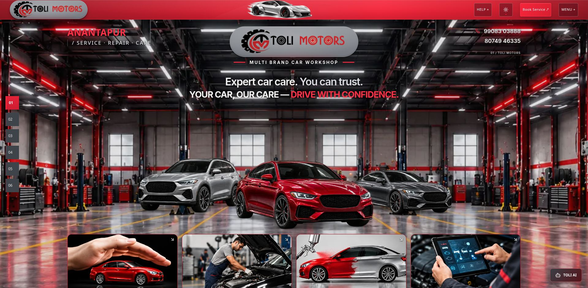
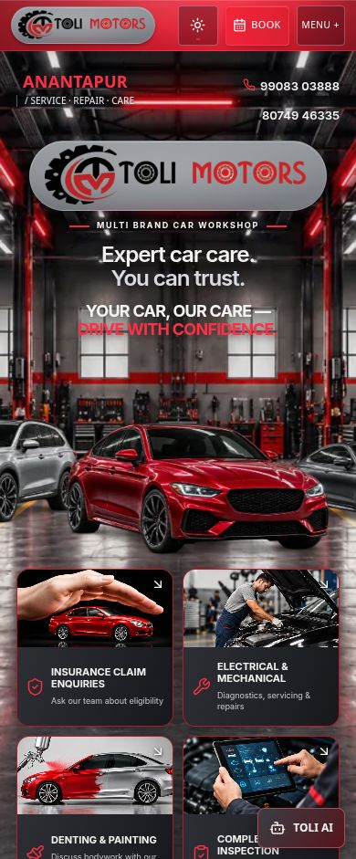
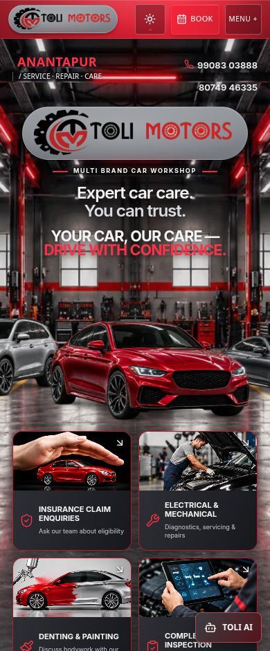

# Hero caption size

Only implementation file changed: `src/components/journey/hero-caption.css`. The slogan is now bold (700) with its existing pearl-white and bright-red emphasis in the dark workshop theme. Its responsive font sizes increased by 20%: desktop 24→28.8px at 1920px; 19.44→23.328px at 1440px; mobile 17→20.4px at 320px and 17.94→21.528px at 390px. Near the upper tablet breakpoint it is capped at 24px rather than 26.4px to stay smaller than the 25px main heading.

The existing responsive line-box height is retained so enlarging the letters does not reflow the Hero. Heading position and font size are unchanged at every checked size. Vehicle and section bounds remain unchanged except for browser rounding of at most 0.032px. Gap remains 10px desktop/tablet and 12px mobile. The slogan stays centered directly below the heading, with no vehicle overlap. Existing subtle dark-theme shadow is retained.

Checked 320, 390, 430, 768, 900, 1440 and 1920px: no horizontal overflow; complete caption visible; caption smaller than heading. Logo/pill, cars, workshop framing and lighting, corner text, navbar, other sections and separate 3D project were not edited. No assets, dependencies or tests changed.

Build, TypeScript app/node/QA and lint: PASS. Relevant tests: 37 passed across 3 files. Production console: no captured warnings or errors. Existing build notices concern Browserslist data, Tailwind ambiguity and bundle size. No deployment performed.

| Desktop before | After |
|---|---|
|  |  |

| Mobile before | After |
|---|---|
|  |  |

Exact CSS change is in `change.diff`; viewport measurements are in `comparison.json`. Preview: http://127.0.0.1:8190/Toli-2/ .
