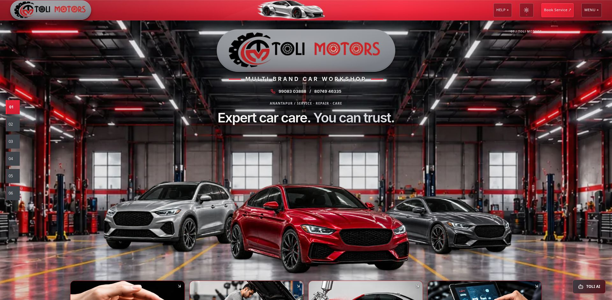
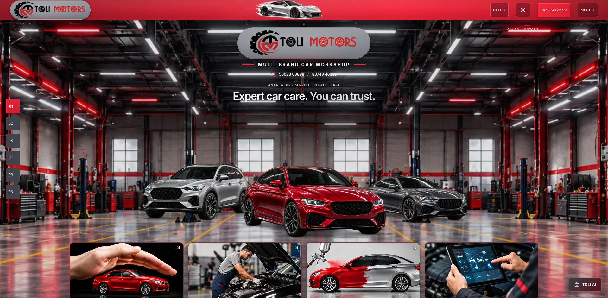
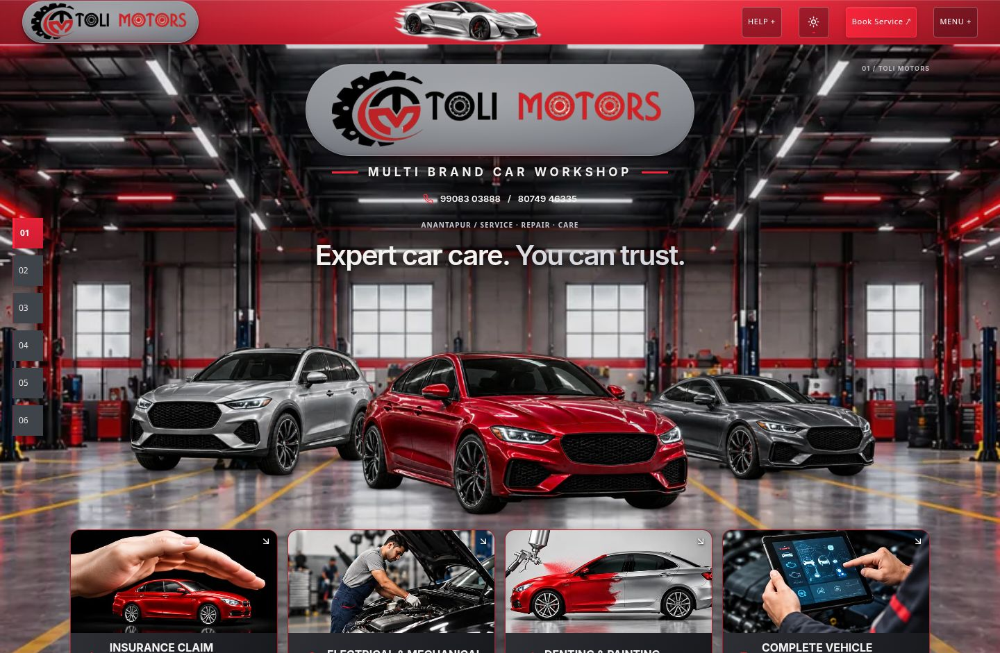
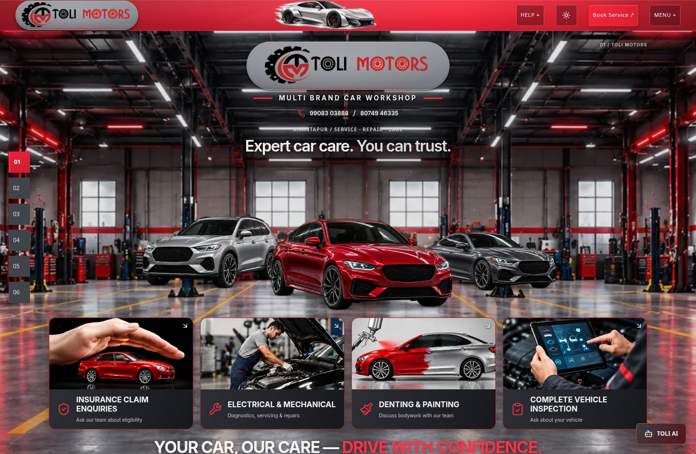
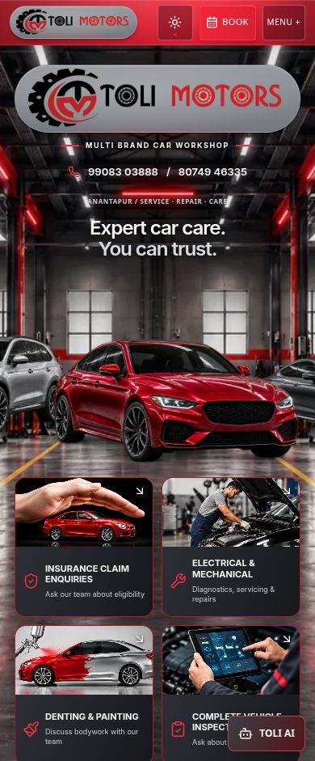
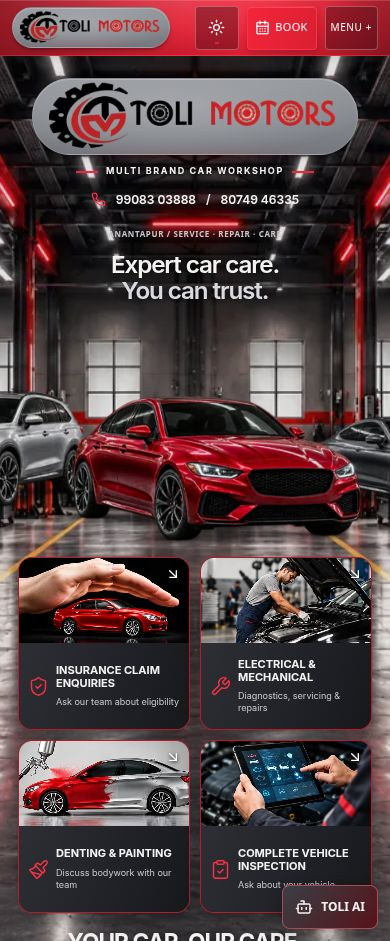

# Further cinematic Hero compression

This adjustment is relative to the immediately preceding Hero, not the original single-car design. The three-car image is 20% smaller on desktop/tablet; the desktop logo is 25% smaller, subtitle about 18% smaller and heading about 20% smaller. Phone text has a restrained 13→12px reduction to retain readability and its existing touch target. No whole-Hero transform is used.

## Dimensions

Rendered image dimensions below describe the full transparent three-car group, calculated from its displayed width and unchanged 1600×372 artwork aspect ratio; the group is cropped intentionally at mobile viewport edges.

| Viewport | Vehicles before → after | Logo pill before → after | Hero height before → after |
|---|---|---|---|
| 1920px | 1295×301 → 1036×241px | 560×133 → 420×100px | 1423 → 1288px |
| 1440px | 1084×252 → 867×202px | 560×133 → 420×100px | 1272 → 1147px |
| 768px | 620×144 → 496×115px | 520×123 → 416×99px | 1123 → 1031px |
| 390px | 696×162 → 661×154px | 354×84 → 326×77px | 1370 → 1324px |

Desktop heading: 42→34px at 1920; 40.32→32.26px at 1440. The tablet 25px minimum and mobile 24–27px responsive heading are retained. Mobile uses only a 5% additional vehicle reduction and an 8% logo reduction, keeping the sedan prominent and all text legible.

## Spacing and background

- Desktop grid gap 14→10px; mobile 14→12px.
- Desktop logo-to-subtitle margin 12→8px; phone margin 10→6px.
- Desktop top padding 28→22px; tablet 24→20px; mobile 24→22px.
- Vehicle row `minmax(280px,24vw)` → `minmax(260px,22vw)`; mobile 240→228px. The row remains tall enough for workshop depth rather than collapsing tightly around the cars.
- Desktop background top extension −420→−380px. Combined with the shorter content-driven Hero, this reduces the existing image's cover enlargement and reveals more of the side bays, ceiling, cabinets and floor. Bottom-aligned cover preserves aspect ratio and full coverage. The crop was visually refined to keep recessed vehicle tires on the floor. Mobile portrait framing is unchanged.

The red sedan remains the largest foreground car. SUV and coupe retain their existing relative placement, proportions, lighting and contact shadows. No assets or colors were changed. The metallic logo material is still the actual shared navbar pill, with original artwork; only size changes.

## Identical-viewport visual comparisons

| Desktop 1920×941 before | After |
|---|---|
|  |  |

| Desktop 1440×941 before | After |
|---|---|
|  |  |

| Mobile 390×941 before | After |
|---|---|
|  |  |

Additional matching screenshot pairs are saved for 320, 360, 430 and 768px. `comparison.json` records measured bounds. The latest composition was compared with `/home/thunder/Downloads/Dark Garage Hero_ Toli Motors.png`: it retains the dark industrial architecture, red strips, central vehicle focus and photographic cards while deliberately giving the workshop more space. Official branding and generic vehicle artwork remain different from that reference; this pass does not claim exact reference reproduction.

## Responsive and functional validation

Dark: 320, 360, 390, 430, 768, 1440, 1920px. Light: 320, 390, 768, 1440, 1920px. No horizontal overflow. Smaller branding remains centered, text is readable, and vehicle content is fully visible on desktop and intentionally cropped at the sides on mobile. No new clipping or overlap involving the resized elements. No background gaps or stretched imagery. Both theme controls work.

Production build: PASS. All TypeScript configurations: PASS. Lint: PASS. Relevant automated tests: 55 passed across 6 files. Production Book Service opens the shared request dialog; fresh production console has no captured warnings or errors. Logs are saved here. Existing build notices concern Browserslist data, ambiguous Tailwind classes and bundle size; existing React Router future notices remain in tests. No new dependencies, assets, WebGL contexts or continuous animation. No physical-device performance benchmark claimed.

## Files and protection

Only `src/components/journey/hero.css`, `src/components/journey/hero-caption.css` and the intentional Hero CSS hash in `src/test/fixtures/separation-protected.json` changed, plus this evidence folder. No edits to navbar, logo artwork/material styles, vehicle/background assets, copy, Service Request, Gallery, TOLI AI or unrelated sections. See `protection.json` for static, independent 3D and original-project hash comparisons.

Preview: http://127.0.0.1:8190/Toli-2/ . Production verification: http://127.0.0.1:8200/Toli-2/ . Deployment not performed.

| Acceptance | Status |
|---|---|
| Hero content compressed | PASS |
| Wider workshop view | PASS |
| More background detailing visible | PASS |
| Three vehicles preserved | PASS |
| Metallic logo pill preserved | PASS |
| Responsive design | PASS |
| 3D website unchanged | PASS — 1,573 baseline files unchanged |
