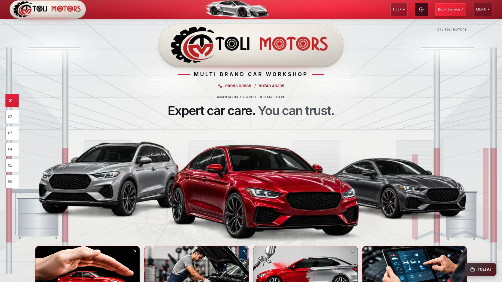

# Hero logo pill

The Hero now renders the existing shared `ToliLogoPill` component at a new `hero` size. It reuses the navbar's actual `.toli-logo-pill` radial/linear metallic gradient, theme variables, 999px corners, subtle border, inset/outer depth shadows and highlight details. The shared material stylesheet is unchanged. Only Hero padding, width and aspect ratio are scoped separately. The original `big-transparent.png` artwork remains unchanged, without recoloring, cropping, regeneration or filters.

The old Hero-only flat rectangular surface and its border/shadow overrides were removed. The existing centered brand width, desktop scale and overall aspect ratio remain intact. Before/after browser measurements match exactly for the brand group, vehicle group and navbar pill at 390px and 1672px.

## Visual evidence

Desktop before: 

Desktop after, showing both shared logo pills: 

Mobile before: 

Mobile after: 

Light-theme desktop: 

Light-theme mobile: 

## Responsive and theme checks

Dark widths: 320, 360, 390, 412, 430, 768, 1024 and 1672px. Light widths: 320, 390, 768 and 1672px. Computed gradient, border, radius and box-shadow match the navbar exactly at every checked size in both themes. No horizontal overflow; original artwork is fully visible and proportionate. See `dark-layout.json`, `light-layout.json` and `before-layout.json`.

## Changes and protection

- `src/components/Hero.tsx`: use shared logo component instead of standalone image.
- `src/components/ToliLogoPill.tsx`: add the Hero size option; existing size output is unchanged.
- `src/components/journey/hero-caption.css`: Hero-only size/padding; remove obsolete rectangular logo treatment.
- `src/test/logo-system.test.tsx`: include Hero size and consumer in existing artwork/theme checks.
- `src/test/fixtures/separation-protected.json`: update only intentionally changed Hero/component hashes.
- This evidence folder.

No edits to the shared logo stylesheet, navbar implementation/styles, original logo bytes, Hero cars/assets, workshop assets/crop, headings, contacts, numbered navigation, other sections or separate 3D project. The source hash audit is in `protection.json`.

## Validation

Build, TypeScript app/node/QA and lint: PASS. Relevant tests: 54 passed across 5 files. Logs are retained in this folder. Existing build warnings concern Browserslist data, ambiguous Tailwind utilities and bundle size. The fresh production browser console has no captured warnings or errors. No added assets, dependencies or animation.

Preview: http://127.0.0.1:8190/Toli-2/ . Production verification: http://127.0.0.1:8200/Toli-2/ . No deployment performed.

Acceptance: the Hero is an enlarged instance of the navbar metallic pill, using the same original artwork and the same material definitions.
