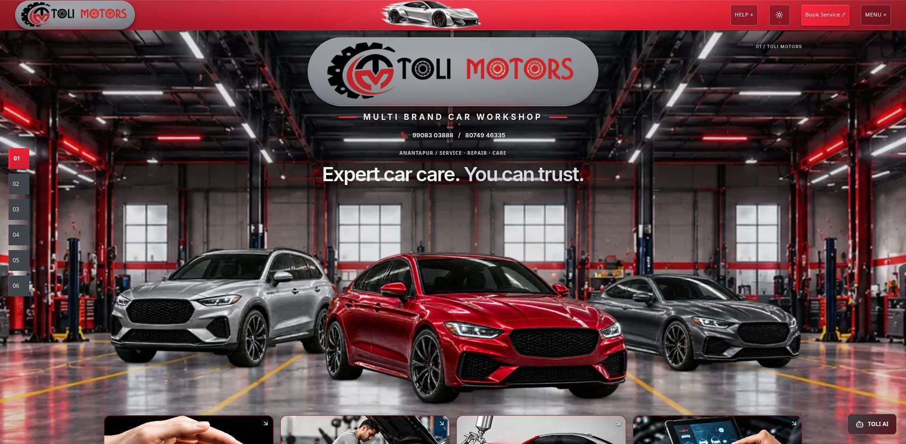
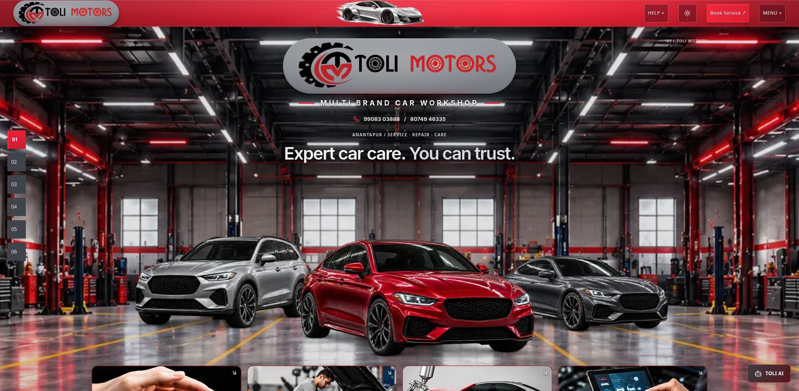
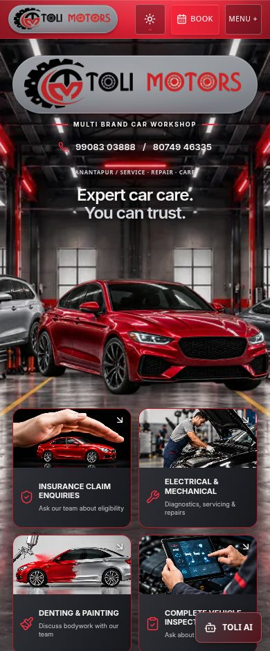
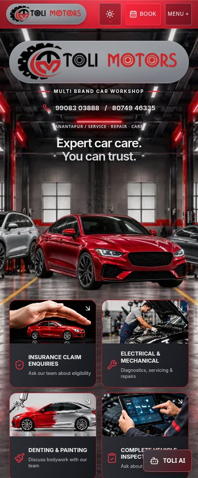

# Hero scale and workshop framing

Vehicles now occupy 87.5% of their former desktop/tablet width (12.5% reduction), centered within the same vehicle row and anchored at the same bottom edge. Mobile uses 90% of its former vehicle width (10% reduction), retaining the red sedan as the focal point. The asset's shared perspective, arrangement, proportions and tire-contact shadows are unchanged. No assets were edited or replaced.

The Hero logo's former desktop 1.1 enlargement was removed: its visible pill width is now 560px rather than 616px, a 9.1% reduction on screens at least 1024px wide. The existing brand row dimensions remain unchanged; mobile/tablet logo size remains as before. Metallic gradient, border, shadows, original artwork and navbar pill are unchanged.

## Background framing

The existing dark landscape background layer now extends 420px above the Hero instead of 500px, reducing its cover enlargement modestly and exposing more ceiling and side architecture. It still uses centered bottom-aligned `cover`, with uninterrupted edge-to-edge coverage. The background's image, lighting overlays and equipment detailing are unchanged. Portrait/mobile and light-theme background framing remain unchanged; smaller vehicles expose more of their existing surroundings. Vehicle bottom alignment is retained so the tires remain on the floor. No transform was applied to the Hero container, no typography was scaled and no section height was reduced.

## Identical viewport comparisons

| Desktop 1920×941 | |
|---|---|
| Before | After |
|  |  |

| Mobile 390×941 | |
|---|---|
| Before | After |
|  |  |

Additional before/after pairs are saved for 320, 360, 430, 768 and 1440px, all with the same 941px viewport height. `production-desktop.png` and `production-mobile.png` confirm the built version.

## Responsive QA

Checked 320, 360, 390, 430, 768, 1440 and 1920px. No horizontal overflow; images loaded. Hero height is exactly unchanged from baseline at every checked width. Vehicle width ratios measured approximately 0.90 on mobile and 0.875 on tablet/desktop. The sedan remains dominant; side vehicles remain fully visible on desktop and deliberately partial on mobile. Visual comparison confirms more ceiling/side-bay structure and more unobstructed floor markings/reflections, without empty edges or new overlaps involving the resized elements. Contact text, headings and controls retain their existing positions.

Light-theme checks at 390 and 1440px also have no horizontal overflow. Theme switching works both ways. Fresh production console has no captured warnings or errors. No physical-device or frame-rate benchmark claimed; no new assets, dependencies or rendering work added.

## Files modified

- `src/components/journey/hero.css`: horizontal insets for the smaller vehicle group, retaining bottom alignment.
- `src/components/journey/hero-caption.css`: modest landscape-background crop change and removal of desktop-only logo enlargement.
- `src/test/fixtures/separation-protected.json`: update only the intentionally changed Hero CSS hash.
- This report/evidence folder.

Navbar, navbar sports car, logo artwork, all three vehicle assets, all workshop assets, Hero copy, numbered navigation, TOLI AI and other sections were not edited. See `protection.json` for baseline comparisons of the static, independent 3D and original projects.

## Validation

Production build: PASS. TypeScript app/node/QA: PASS. Lint: PASS. Relevant automated tests: 26 passed across 5 files, covering vehicle presentation, Hero, logo, navbar and protection checks. Existing build notices concern Browserslist data, ambiguous Tailwind utility names and bundle size; test output retains existing React Router future notices. Logs are saved alongside this report.

Preview: http://127.0.0.1:8190/Toli-2/ . Production verification: http://127.0.0.1:8200/Toli-2/ . No deployment performed.

| Acceptance | Status |
|---|---|
| Hero composition reduced | PASS |
| More workshop detailing visible | PASS |
| Three cars preserved | PASS |
| Metallic logo pill preserved | PASS |
| Full background coverage | PASS |
| Responsive design | PASS |
| 3D website unchanged | PASS — 1,573 baseline files, no changes |
