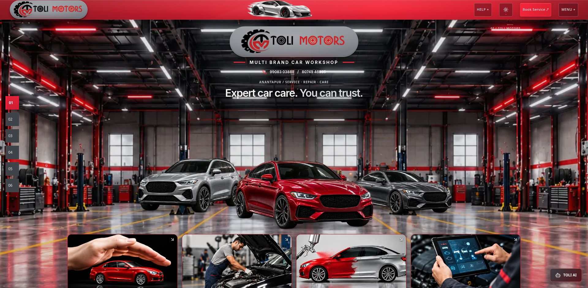
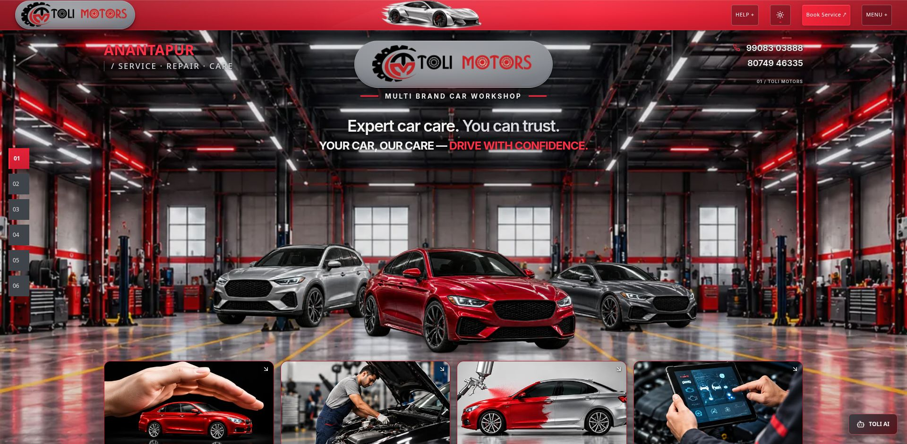
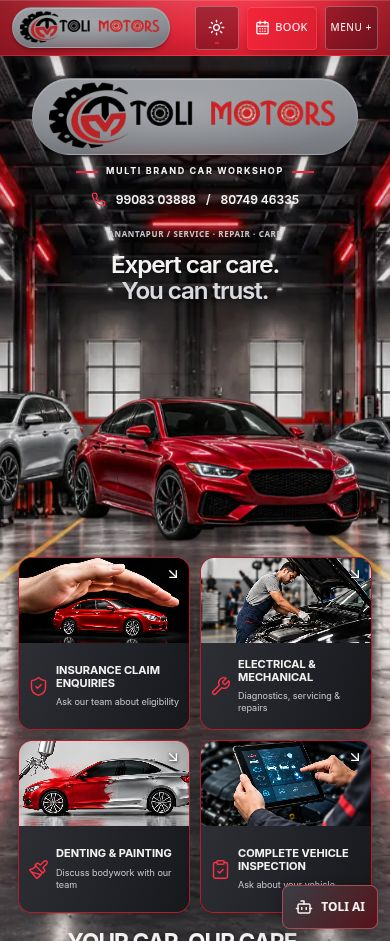
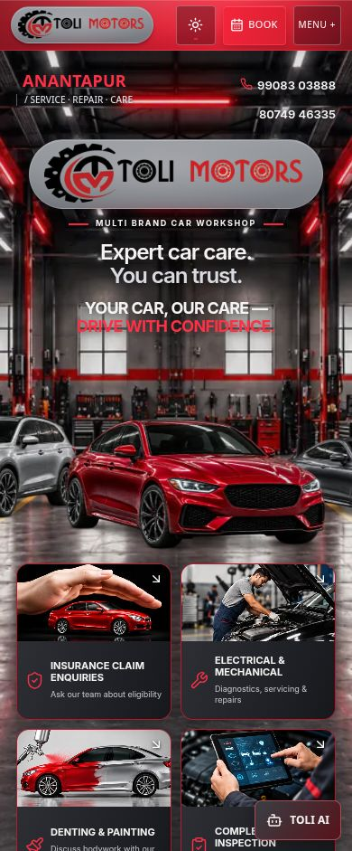

# Hero text hierarchy

Location moved from the central eyebrow position to the Hero's upper-left corner. The two verified phone links moved from below the workshop subtitle to the upper-right corner. The slogan now sits directly below the main heading, forming a centered headline group; it no longer renders below the service cards.

## Typography and layout

- Location uses two lines: bold bright-red ANANTAPUR at 24–30px on desktop, followed by metallic-silver SERVICE · REPAIR · CARE at 14–17px. Original wording and slash retained. Mid-size desktop uses 22/12px to keep clear of the centered logo. Mobile uses 18/10px.
- Phone numbers remain `99083 03888` (`tel:+919908303888`) and `80749 46335` (`tel:+918074946335`), arranged as two 15–18px desktop rows with a small red phone icon. Mobile uses 13px and preserved 32px link heights. No contact card or new business data.
- Primary heading retains its approved size and wording. The slogan uses 18–24px desktop type and 17–20px mobile type, pearl-white with bright-red emphasis. Measured heading-to-slogan gap is 10px desktop/tablet and 12px mobile.
- Desktop corner information shares the top CSS grid row with the centered brand, in nonoverlapping side areas. No absolute positioning for the corner text blocks. A reserved brand-row allowance keeps the approved vehicle track in place when relocating text.
- Below 901px the corner groups form a separate two-column row above the logo; the headline/slogan stay together. Normal responsive document flow accommodates the additional text. The small `01 / TOLI MOTORS` technical marker moves clear of the contact block; the numbered chapter navigation is unchanged.

## Preservation

Vehicle group width and height are identical before/after at 320, 360, 390, 430, 768, 1024, 1440 and 1920px. Desktop placement differs by only 0.015625px from CSS rounding. Logo artwork, size, centered position and metallic material remain unchanged on desktop. On mobile/tablet the complete vehicle group naturally moves down 42.5–70.3px as the corner/header content stacks; its scale, relative car arrangement, assets and controls remain unchanged.

No workshop asset, lighting effect or approved top crop was edited. Removing the old lower slogan shortens desktop content; a calculated extension of the background image plane retains its previous rendered height/crop rather than letting `cover` reframe the workshop. It remains clipped by the full-bleed Hero, with no empty edges. Mobile keeps its existing portrait image framing rules and follows responsive content flow.

## Before and after at identical viewport sizes

| 1920×941 before | After |
|---|---|
|  |  |

| 390×941 before | After |
|---|---|
|  |  |

Matching before/after screenshots are also saved for 320, 360, 430, 768, 1024 and 1440px. Light-theme screenshots are saved for 320, 390, 768, 1024, 1440 and 1920px.

## Validation

Dark responsive checks: 320, 360, 390, 430, 768, 1024, 1440 and 1920px. No horizontal overflow or intersections between location/contact and central logo. Heading and slogan remain separated by the intended gap. On desktop all headline text stays above the vehicle group. See `after.json` and `comparison.json` for rectangles, typography and unchanged phone destinations. Both theme switches work, and light layouts have no overflow.

Production build: PASS. All TypeScript configurations: PASS. Lint: PASS. Relevant automated tests: 55 passed across 6 files. Tests now verify the slogan directly follows the heading, both phone links live in the corner information group, and location text retains its exact content. Existing vehicle, identity, navigation and protection coverage passes. Production console has no captured warnings or errors. Build/test logs retain pre-existing Browserslist, Tailwind ambiguity, bundle-size and React Router future notices.

## Files modified

- `src/components/Hero.tsx`: relocate phone group; group top-corner information; add two-line location markup. Existing heading/slogan DOM order is retained.
- `src/components/journey/hero-caption.css`: responsive corner grid, location/contact typography, slogan placement and background-plane height compensation.
- `src/test/hero-reference.test.tsx`: verify relocated phone/location groups and heading/slogan relationship.
- `src/test/navbar-motion.test.tsx`: retain exact-location assertion with the new two-line markup.
- `src/test/fixtures/separation-protected.json`: refresh only the intentionally changed Hero source hash.
- This report and evidence folder.

No edits to navbar implementation/styles or silver car, official logo artwork/material stylesheet, vehicle assets/component, workshop assets, chapter navigation, Service Request, Gallery, TOLI AI or other sections. Source audit: separate 3D project 1,573 baseline files unchanged; original project 3,128 baseline files unchanged. See `protection.json`.

Preview: http://127.0.0.1:8190/Toli-2/ . Production verification: http://127.0.0.1:8200/Toli-2/ . No deployment performed.

| Acceptance | Status |
|---|---|
| Top-left location heading | PASS |
| Top-right contact information | PASS |
| Slogan below main heading | PASS |
| Metallic logo pill preserved | PASS |
| Three vehicles unchanged | PASS — responsive flow caveat above |
| Workshop detailing preserved | PASS |
| Responsive design | PASS |
| 3D website unchanged | PASS |
