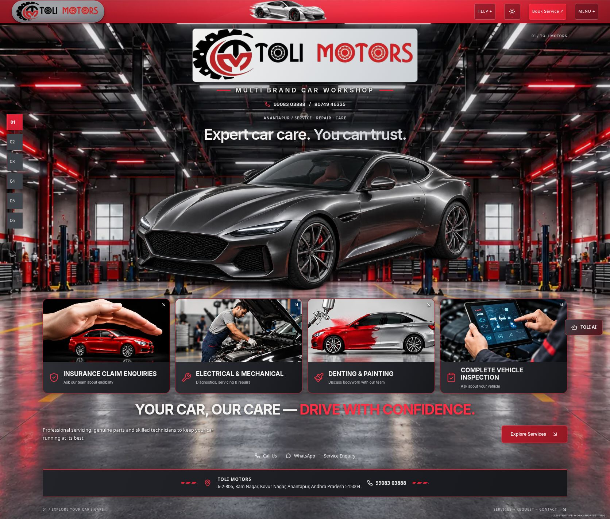
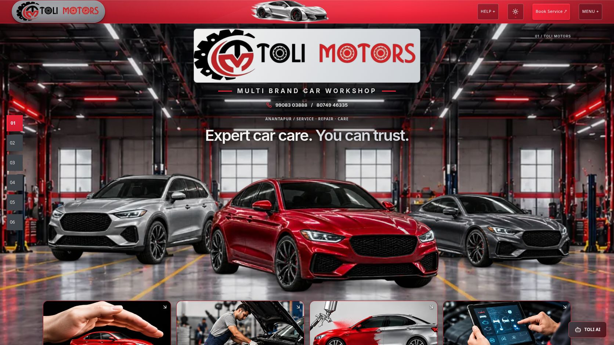
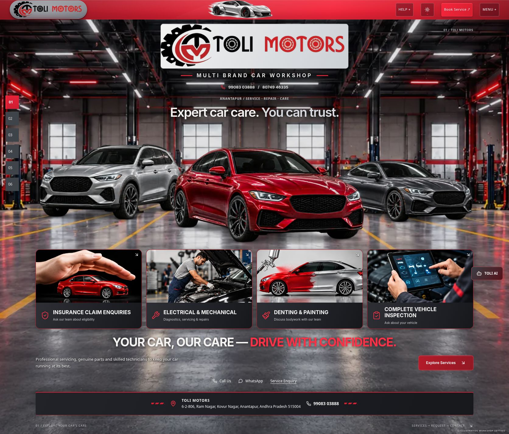
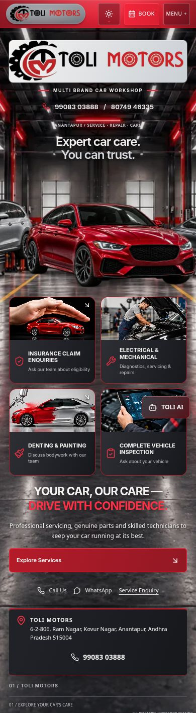

# Three-car Hero replacement

The static Hero now shows a metallic silver SUV at left, a dominant deep-red four-door sedan in front and a recessed graphite coupe at right. The three vehicles share one transparent photographic-style composition for coherent lighting, perspective, occlusion and tire shadows. They are generic illustrative designs, not named production models or customer vehicles. See [source and exact prompts](ASSET-SOURCE.md).

## Before and after

Before: 

Desktop: 

Complete homepage Hero: 

Mobile: 

## Implementation and cleanup

Removed the old campaign picture from `src/components/Hero.tsx`. Replaced the unused reserved-assets/fallback logic in `src/components/journey/HeroVehicleLineup.tsx` with the actual responsive three-car picture. Removed obsolete campaign placement, glow and slot rules from `hero.css`, plus its redundant compact-screen override in `experience.css`. Removed the unused `src/lib/hero-vehicle-assets.ts` contract and its null-asset tests.

Removed Hero-only `toli-sports-campaign-960.webp` and `toli-sports-campaign-1440.webp` after confirming there were no remaining runtime consumers. Their historical generation record remains marked retired. The current Hero was already image-only: there was no Hero-specific camera/control implementation or renderer dependency to remove. Shared Three.js, scene utilities and other-section vehicles remain intact. Navbar vehicle assets are independent and unchanged.

New assets: `src/assets/hero/workshop-three-cars-960.webp` (61,512 bytes), `src/assets/hero/workshop-three-cars-1600.webp` (134,894 bytes). Both preserve alpha; desktop version is 1600×372. Generated using built-in imagegen, then transparently trimmed and encoded as responsive WebP with Sharp. No stock-photo license or third-party model is claimed. No additional library, video, renderer, WebGL context or continuous animation. Restrained entrance fade respects reduced motion. Largest vehicle derivative decreased from 175,648 to 134,894 bytes (23%); total derivative storage decreased from 265,970 to 196,406 bytes. Actual selection depends on viewport and device pixel ratio. No physical low-end-device benchmark claimed.

The existing workshop asset and equipment details remain intact. Its desktop crop was raised to align the recessed tires with the floor rather than the rear wall. Mobile retains the existing portrait environment and prioritizes the red sedan; only portions of the secondary cars appear at the sides. Brand presentation, navbar, slogan, address, contact details and four service cards are unchanged.

## Validation and protection

Dark viewport checks: 320, 360, 390, 412, 430, 768, 1024, 1440, 1672, 1920px. Light checks: 320, 390, 768, 1672px. No horizontal overflow; vehicle image loaded and old campaign absent; all four cards retained. Desktop and mobile screenshots inspected for vehicle proportions, clipping, floor alignment and readable content.

Book Service verified opening the existing request popup. Mobile production menu retains all six chapter destinations, Help and Request Service. Theme switching verified both ways. Existing automated coverage continues checking request routing, service context, gallery, enquiry drafts, form validation, scene coordination and navigation. No external form submission performed.

Production build, TypeScript app/node/QA and lint passed. Build retains existing Browserslist, Tailwind ambiguity and bundle-size notices. Fresh production console has no captured warnings or errors. All 383 automated tests passed across 54 files; final targeted verification also passed 46 tests across 5 files. Results are recorded in `tests.log` and `targeted-tests.log`. Replaced the two obsolete null-lineup tests with coverage of the actual responsive composition, priority loading and absent old campaign/renderer; updated intentional Hero hashes in the separation fixture.

See [protection audit](protection.json) for the exact source changes. Separate 3D website: 1,573 baseline files, no changes/additions/removals. Original project: 3,128 baseline files, no changes/additions/removals. Unrelated static sections, navbar implementation and official logo artwork are unchanged.

Preview: http://127.0.0.1:8190/Toli-2/ . Production verification: http://127.0.0.1:8200/Toli-2/ . No deployment performed.

## Acceptance

| Check | Status |
|---|---|
| Old Hero car removed | PASS |
| Three realistic cars implemented | PASS — illustrative photographic artwork |
| Red sedan prominent | PASS |
| Workshop background preserved | PASS — same assets, adjusted desktop floor crop |
| Reference visual match | PARTIAL — requested vehicle arrangement implemented; existing official branding/layout retained |
| Responsive design | PASS — browser viewport QA |
| Functional regression | PASS — full suite and checked browser interactions |
| 3D website protection | PASS |
| Deployment | NOT PERFORMED |
