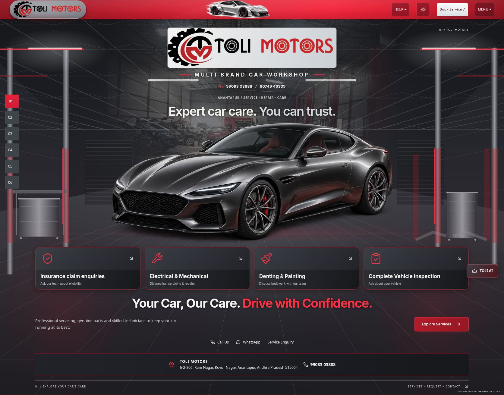
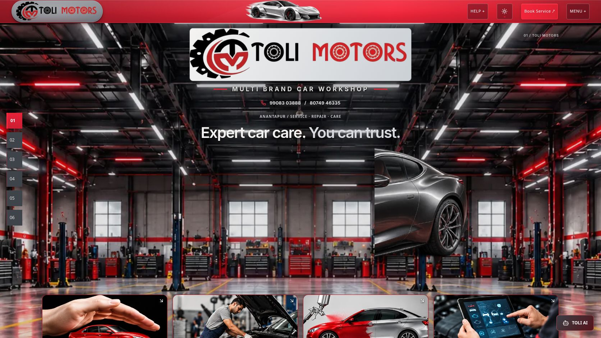
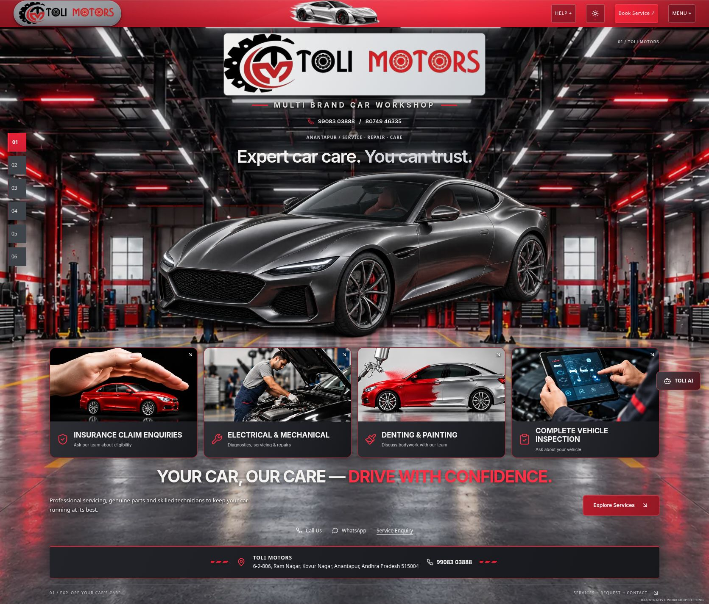
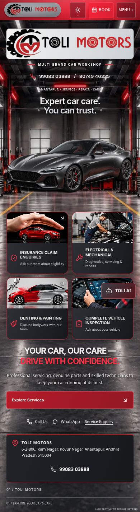
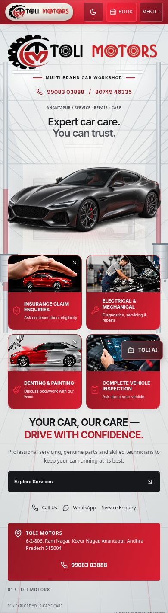

# Uploaded dark-garage reference recreation

Reference inspected: YES — `/home/thunder/Downloads/Dark Garage Hero_ Toli Motors.png` (1672×941).

Before: 

After at the reference viewport: 

Complete Hero: 

Mobile dark: 

Mobile light: 

## Result and remaining differences

The static homepage now uses a photographic illustrative graphite workshop, red architectural lights, trusses, side bays, cabinets, lifts and a reflective floor. Four separate interactive photographic service cards, uppercase pearl-white/red slogan and industrial address strip follow the reference hierarchy. The red navbar retains the silver animated car, official logo, help, theme, booking and menu controls; its booking button has the reference's red finish.

Reference fidelity is PARTIAL, not an exact reproduction. The approved existing vehicle is a graphite sports-car picture presentation, not the red front-facing BMW in the reference. Its picture source, rendering component, placement and size remain unchanged. The official horizontal black/red logo remains intact on a neutral surface rather than imitating the reference's separate stacked metallic emblem/wordmark. Preserving the existing car and heading also makes the complete Hero taller than the 941px reference: the cards, slogan and address continue below the first viewport. No false claim of a newly interactive Hero car is made; this static site's current Hero does not expose inspection controls. Other existing renderers remain untouched.

The reference's GSTIN, Telugu wording, alternate phone/address and cashless-availability claim were not published without authoritative approval. Existing project contact information is retained. The first card invites insurance enquiries and asks the team to confirm eligibility. The workshop and service artwork are illustrative, not photographs of the actual facility; the Hero carries the illustrative-workshop label and service group identifies illustrative images.

## Three review passes

1. Composition: compared the actual 1672×941 browser rendering and full Hero with the uploaded reference. Added a clean environment plate and four independent photo surfaces; retained original car bounds and all real React controls. `pass1-fullhero.png` records this review.
2. Materials and lighting: checked ceiling detail, red/white strips, service-image crops and reflective-floor alignment. Added restrained lower-floor contrast support for contact copy without an opaque content box. `pass2-1672.png` records the lighting pass.
3. Fine details and responsiveness: inspected mobile two-column cards, portrait workshop framing, slogan wrapping, red icons and address accents; verified navigation and booking controls. `pass3-1672.png`, `dark-390.png`, responsive matrices and production screenshots record final evidence.

## Functionality and responsive evidence

- All four service cards open the shared Service Request popup; Electrical & Mechanical also verified with keyboard Enter. Automated tests preserve canonical destination and service context for every card.
- Header Book Service and mobile-menu Request Service open the same popup. No form submission or external contact transmission performed.
- Six desktop chapter buttons clicked; mobile menu exposes all six chapters, Help and Request Service. Help expanded correctly. Theme switching checked both ways.
- Dark widths: 320, 360, 390, 412, 430, 768, 1024, 1366, 1440, 1920. Light widths: 320, 360, 390, 412, 430, 768, 1024, 1440, 1672. No document horizontal overflow. Desktop evidence also captured at reference dimensions 1672×941.
- Original car bounds match baseline at 390px (x16.625/y368.421875/w346.734375/h185) and 1440px (x76.234375/y403.234375/w1277.53125/h345.59375).
- Mobile deliberately prioritizes logo, theme, Book and Menu; car/help remain available according to existing responsive navbar policy. The page rail is replaced by its existing menu navigation on narrow screens.

## Performance and assets

Built-in imagegen created only clean environmental and service imagery. Exact final prompts are in `ASSET-PROMPTS.md`. Four optimized WebP assets total 555,810 bytes in source: desktop 1600px 233,162; tablet 960px 102,338; mobile portrait 640px 121,586; shared four-image service atlas 98,724. A visitor loads the applicable environment variant plus one atlas. No added video, library, canvas, WebGL context or continuous animation. Existing motion preserved; service-card transitions disabled with reduced motion. No physical low-end-device or FPS/LCP benchmark claimed.

## Validation

- Production build: PASS. Existing Browserslist, ambiguous Tailwind utility and bundle-size notices remain in build log.
- TypeScript app, node and QA configurations: PASS.
- Lint: PASS.
- All automated tests: 385 PASS across 54 files. Expected React Router future notices appear in test output.
- Fresh production browser console: no captured warnings or errors; Hero image elements loaded, and background/card URLs resolve to hashed production WebP assets.
- Preview: http://127.0.0.1:8190/Toli-2/ ; production verification: http://127.0.0.1:8200/Toli-2/ .

## Changed files and protection

Implementation: `src/components/Hero.tsx`, `src/components/journey/BrandCaption.tsx`, `src/components/journey/hero-caption.css`, `src/components/journey/navbar-brand.css`, and four `src/assets/hero/garage-*.webp` assets. Tests: Hero reference and navbar caption expectations, plus intentional Hero hash in separation fixture. Evidence and prompts are in this folder. See `protection.json` for exact baseline comparisons.

Unrelated static sections, business logic, dependencies, official logo artwork and vehicle assets were not edited. The separate 3D website and original project were compared to pre-edit hashes. No deployment performed.

## Final status

| Requirement | Status |
|---|---|
| Reference image match | PARTIAL — documented protected-car/logo and height differences |
| Full workshop background | PASS |
| Existing Hero car | PRESERVED |
| Navbar | PASS |
| Branding | PARTIAL — official artwork preserved; no imitation metallic logo |
| Service cards | PASS |
| Responsiveness | PASS — browser viewport checks |
| Functional regression | PASS — checked interactions and full suite |
| 3D website protection | PASS — see hash audit |
| Deployment | NOT PERFORMED |
